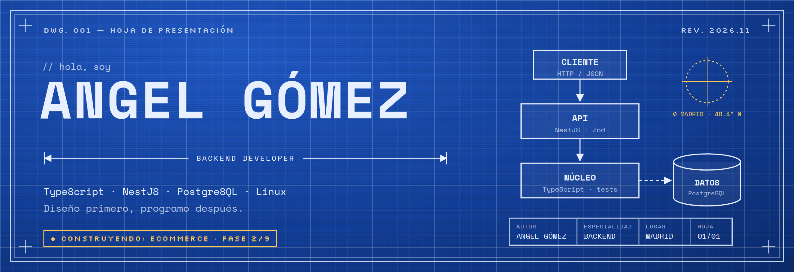
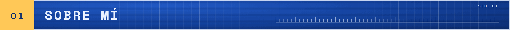
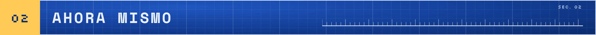
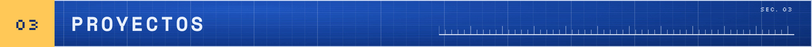
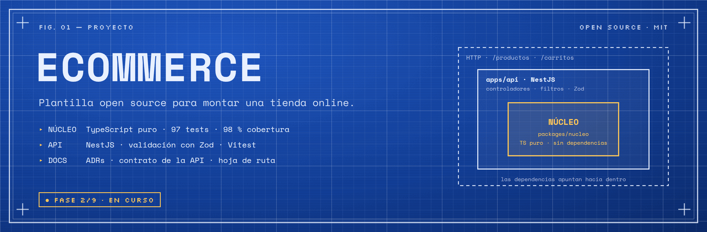
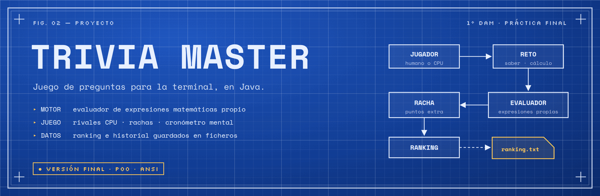
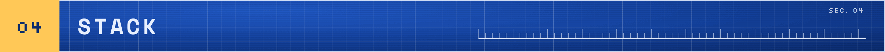
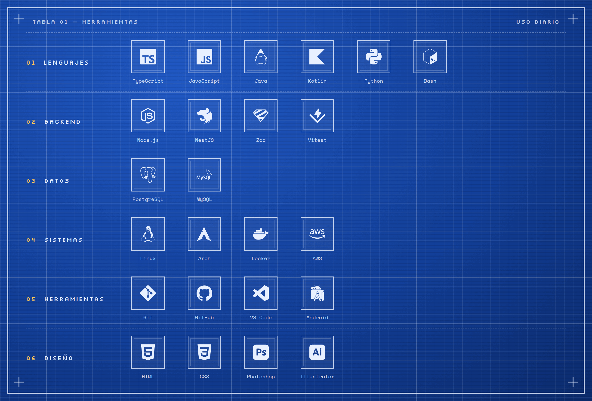
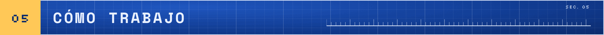

<div align="center">
  
  <br/><br/>
  <a href="https://www.linkedin.com/in/angelgmx"></a>
  <a href="mailto:ag.delbarrio@outlook.es"></a>
  
</div>

<br/>



- Estudiante de **2º de DAM**, con **SMR** terminado: vengo de redes y sistemas.
- Me centro en el **backend**: APIs, bases de datos y arquitectura.
- Trabajo en **Linux** (Arch) desde la terminal.
- Mi forma de trabajar: **diseñar antes de programar**, decidir con ADRs y probar con tests.



- **Construyendo** [`ecommerce`](https://github.com/angelgmx/ecommerce): API REST con NestJS, fase 2 de 9.
- **Aprendiendo** NestJS, diseño de APIs REST y PostgreSQL.
- **Siguiente:** Docker, colas de mensajes y AWS (Solutions Architect).



<a href="https://github.com/angelgmx/ecommerce"></a>

<a href="https://github.com/angelgmx/trivia-master"></a>







```text
01  REQUISITOS      qué tiene que hacer y qué no
02  DECISIÓN        un ADR por cada elección importante
03  CONTRATO        la API diseñada antes de escribirla
04  CÓDIGO + TESTS  núcleo sin dependencias, probado
05  PULL REQUEST    revisión antes de llegar a main
```

<div align="center">
  <br/>
  <sub><i>«Cada error es un paso hacia dominar este mundo».</i></sub>
</div>
