<div align="center">
  
  <br/><br/>
  <a href="https://www.linkedin.com/in/angelgmx"></a>
  <a href="mailto:ag.delbarrio@outlook.es"></a>
  
</div>

## `01` Quién soy

Soy **Angel**, desarrollador **backend** en formación. Estudio **2º de DAM** y antes terminé **SMR**, así que vengo de redes y sistemas: entiendo lo que pasa por debajo del código.

Me gusta construir la parte que no se ve: **APIs, bases de datos y la lógica que hace que una aplicación funcione bien**.

## `02` Qué hago y por qué

Construyo **proyectos propios, de principio a fin, escribiendo yo el código**. Cada uno me sirve para aprender algo nuevo y para demostrar cómo trabajo:

- 📐 **Diseño antes de programar:** requisitos, decisiones documentadas en ADRs y el contrato de la API antes de la primera línea.
- 🧪 **Pruebo lo que escribo:** tests automáticos desde el principio, no al final.
- 🔀 **Trabajo como en un equipo:** ramas, pull requests y commits claros, aunque el proyecto sea mío.
- 📖 **Documento:** para que cualquiera pueda entender el proyecto y contribuir.

## `03` Qué estoy aprendiendo

| Ahora | Después |
| --- | --- |
| NestJS y diseño de APIs REST | Docker y despliegue |
| PostgreSQL y modelado de datos | Pagos y colas de mensajes |
| Testing con Vitest | AWS (Solutions Architect) |

## `04` Mis objetivos

- 🎯 **Corto plazo:** terminar la API de [`openecommerce`](https://github.com/angelgmx/ecommerce) y conseguir mi **primer puesto como desarrollador backend junior**.
- 🚀 **Medio plazo:** diseñar sistemas que aguanten usuarios reales y certificarme en **AWS**.
- 🌱 **Siempre:** seguir aprendiendo y crear proyectos que aporten valor real a personas y empresas.

## `05` Proyectos

<table>
  <tr>
    <td width="50%" valign="top">
      <a href="https://github.com/angelgmx/ecommerce"></a>
      <h3><a href="https://github.com/angelgmx/ecommerce">openecommerce</a></h3>
      <p>Plantilla open source para montar tu propia tienda online, sin plataformas cerradas.</p>
      <ul>
        <li>Núcleo en TypeScript puro: <b>97 tests</b>, <b>98 % de cobertura</b></li>
        <li>API con NestJS y validación con Zod</li>
        <li>Decisiones en ADRs y contrato de API antes del código</li>
      </ul>
      
      
      
      
    </td>
    <td width="50%" valign="top">
      <h3><a href="https://github.com/angelgmx/trivia-master">🧠 Trivia Master</a></h3>
      <p>Juego de preguntas para la terminal. Práctica final de 1º de DAM, donde junté todo lo aprendido en el primer año.</p>
      <ul>
        <li>Evaluador de expresiones matemáticas propio</li>
        <li>Rivales CPU, rachas y cronómetro mental</li>
        <li>Ranking e historial guardados en ficheros</li>
      </ul>
      
      
      
    </td>
  </tr>
</table>

## `06` Stack

<table>
  <tr>
    <td><b>Lenguajes</b></td>
    <td>&nbsp;&nbsp;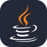&nbsp;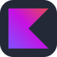&nbsp;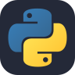&nbsp;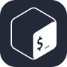</td>
  </tr>
  <tr>
    <td><b>Backend</b></td>
    <td>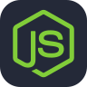&nbsp;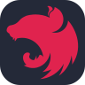&nbsp;</td>
  </tr>
  <tr>
    <td><b>Datos</b></td>
    <td>&nbsp;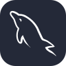</td>
  </tr>
  <tr>
    <td><b>Sistemas</b></td>
    <td>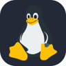&nbsp;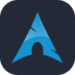&nbsp;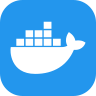&nbsp;</td>
  </tr>
  <tr>
    <td><b>Herramientas</b></td>
    <td>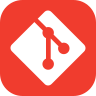&nbsp;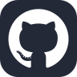&nbsp;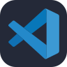&nbsp;</td>
  </tr>
  <tr>
    <td><b>Diseño</b></td>
    <td>&nbsp;&nbsp;&nbsp;</td>
  </tr>
</table>

## `07` Cómo trabajo

```text
01  REQUISITOS      qué tiene que hacer y qué no
02  DECISIÓN        un ADR por cada elección importante
03  CONTRATO        la API diseñada antes de escribirla
04  CÓDIGO + TESTS  núcleo sin dependencias, probado
05  PULL REQUEST    revisión antes de llegar a main
```

## `08` Contacto

¿Hablamos? Escríbeme a **ag.delbarrio@outlook.es** o por [LinkedIn](https://www.linkedin.com/in/angelgmx).

<div align="center">
  <br/>
  <sub><i>«Cada error es un paso hacia dominar este mundo».</i></sub>
</div>
