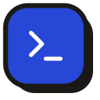
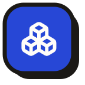

<picture>
  <source media="(prefers-color-scheme: dark)" srcset="assets/portada-oscura.png" />
  
</picture>

**Backend developer que diseña APIs con TypeScript, NestJS y PostgreSQL, con la base de alguien que viene de sistemas.**

##  Sobre mí

Estudié redes y sistemas (SMR) antes de programar, así que pienso en el código y también en la máquina donde corre. Ahora curso 2º de DAM en Madrid.

Antes de escribir una línea, decido y dejo por escrito el porqué: cada elección importante de mis proyectos tiene su ADR.

##  Ahora mismo

Noviembre de 2026

- 🛠️ **Construyendo** la API de [openecommerce](https://github.com/angelgmx/ecommerce) con NestJS: [fase 2 de 9](https://github.com/angelgmx/ecommerce/blob/main/docs/roadmap/fase-2-api.md).
- ✅ **Último hito:** el [contrato de la API](https://github.com/angelgmx/ecommerce/blob/main/docs/arquitectura/api.md), con cada error del dominio traducido a su código HTTP.
- 📚 **Estudiando** filtros de excepciones, tests e2e y monorepos con npm workspaces.

##  Proyectos

<table>
  <tr>
    <td width="50%" valign="top">
      
      <h3><a href="https://github.com/angelgmx/ecommerce">openecommerce</a></h3>
      
Plantilla open source para montar tu propia tienda online, sin plataformas cerradas.

      <ul>
        <li>Núcleo en TypeScript puro: <b>97 tests</b>, <b>98 % de cobertura</b></li>
        <li>API con NestJS y validación con Zod</li>
        <li><a href="https://github.com/angelgmx/ecommerce/tree/main/docs/adr">9 decisiones documentadas en ADRs</a> y contrato de la API antes del código</li>
      </ul>
      
      
      
      
    </td>
    <td width="50%" valign="top">
      <h3><a href="https://github.com/angelgmx/trivia-master">🧠 Trivia Master</a></h3>
      
Juego de preguntas para la terminal. Práctica final de 1º de DAM, donde junté todo lo aprendido en el primer año.

      <ul>
        <li>Evaluador de expresiones matemáticas propio</li>
        <li>Rivales CPU, rachas y cronómetro mental</li>
        <li>Ranking e historial guardados en ficheros</li>
      </ul>
      
      
      
    </td>
  </tr>
</table>

##  Casos de estudio

> [!NOTE]
> **En preparación.** Artículos cortos sobre problemas reales que he resuelto en openecommerce:
>
> - Diseñar el contrato de una API antes de escribir código.
> - Por qué un cupón inválido es un `400` y no un `404`.
> - Un núcleo de dominio que no depende del framework.

##  Objetivos

- Llevar [openecommerce](https://github.com/angelgmx/ecommerce) a producción: pagos, colas y despliegue.
- Certificarme en **AWS Solutions Architect**.
- Trabajar en un equipo backend donde se cuide la calidad del código.

##  Stack

<picture>
  <source media="(prefers-color-scheme: dark)" srcset="assets/stack-oscura.png" />
  
</picture>

📫 <b>ag.delbarrio@outlook.es</b> · <a href="https://www.linkedin.com/in/angelgmx">LinkedIn</a>

